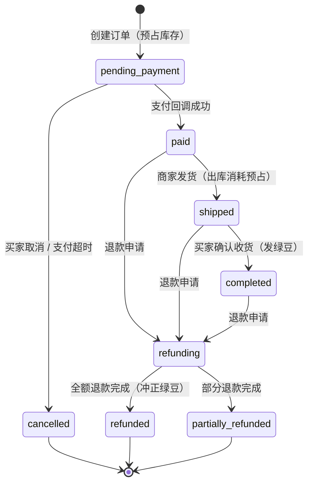

# 状态机规范

所有状态迁移只能通过服务层动作触发，非法迁移返回 `ORDER_STATE_INVALID`（409）。
每次迁移写入 `order_status_logs`（含操作者与动作）。

## 订单（父订单 orders 与店铺子单 store_orders 同构）



合法迁移表（代码位置：`app/modules/orders/models.py ORDER_TRANSITIONS`）：

| 当前状态 | 允许迁移到 |
|---|---|
| pending_payment | paid, cancelled |
| paid | shipped, refunding |
| shipped | completed, refunding |
| completed | refunding |
| refunding | refunded, partially_refunded |
| cancelled / refunded / partially_refunded | （终态） |

父订单状态 = 子订单聚合（`_recompute_parent`）：全部发货→shipped；部分发货→保持 paid；
全部退款→refunded；任一退款>0→partially_refunded；全部完成→completed。

## 支付单（payment_orders）

```
pending → success（回调验签+金额核对+幂等入账）
pending → closed（订单取消/超时）
pending → failed（订单已关闭后收到回调）
success / closed / failed 为终态；重复成功回调幂等返回 duplicate
```

## 退款单（refunds）

```
requested → approved → refunded（Mock 原路退回 + 台账 + 绿豆冲正）
requested → rejected
```

## 商品（products）

```
draft → pending_review（商家提交）
pending_review → approved / rejected（管理员审核，驳回必填原因；通过即自动上架 is_listed=true）
rejected → pending_review（修改后重新提交）
approved + is_listed=false → 上架（商家自主，如曾主动下架）
已上架 → 下架（商家自主）
任意非草稿 → removed（平台强制下架，需 product:remove 权限）
```

## 商家入驻（merchants）

```
pending_review → approved（自动创建默认店铺+店主成员关系）
pending_review → rejected（驳回原因）
approved ⇄ frozen（平台冻结/解冻）
```

## CMS 页面（cms_pages）

```
draft → reviewing → published（发布=整体快照为不可变版本）
published →（修改后再次 publish 生成新版本）
published → 回滚：将指定历史版本快照发布为最新版本（新增版本记录）
公告：draft → published → offline
```

## 绿豆积分流水（point_transactions，仅追加）

```
earn（订单完成发放，幂等键 order_complete:{order_id}）
spend（下单抵扣/兑换）
reverse（退款冲正，幂等键 refund:{refund_id}，按退款比例）
adjust（管理员调整，必填原因+审计）
```
